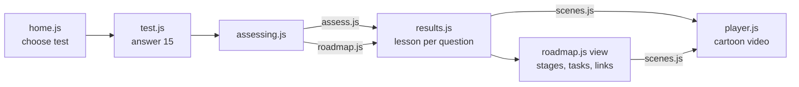

# Architecture

A small single-page app with no framework. `main.js` holds the current **plan** and renders one **view** at a time into `<main id="view">`.



## Layers

| Layer | Folder | Rule |
|---|---|---|
| Data | `src/data` | Plain objects. No logic. |
| Services | `src/services` | Logic only, no DOM. Safe to unit test in Node. |
| UI | `src/ui` | Views read and write `app.plan` and call services. |

## The plan object

One test attempt. Saved to `localStorage` after every change (`services/storage.js`).

```js
{
  id, type: 'subject' | 'role', title, subjectId?, meta?: { role, level, round },
  questions: [...],          // copied from the bank, or written by AI
  answers: [...],            // option index (subject) or text (role); null = unanswered
  times: [...], flags: [...], current: 0,
  stage: 'test' | 'done',
  results: [{ n, score /*0-10*/, correct?, study:[{topic,why}], video:[scene...], model_answer?, improve? }],
  roadmap: { headline, summary, study:[...], stages:[{ title, duration, goal, topics, tasks, resources:[{title,provider,query}], say }], intro_say, outro_say },
  progress: { 0: true, 't0-1': true },   // stage done / task ticked
}
```

## Assessment

`assess.js` splits the 15 questions into 3 batches of 5 and sends them to the AI **in parallel**.

- **Subject:** the score comes from the answer key (`answer` index). The AI receives the correct answer and the verified explanation and only writes the 4-scene lesson.
- **Role:** the AI returns a score from 0 to 10, strengths, improvements, a model answer and the lesson.
- If a batch fails (no AI, network error, bad JSON), `localResult()` builds the feedback for those questions, so the user always gets results.

## AI adapter (`services/ai.js`)

`askJSON(prompt)` is the only AI call in the app. It picks a backend once at start-up:

1. **claude**: `window.claude.use('sample')` when running as a claude.ai artifact
2. **proxy**: `POST /api/ai` on your own server (`server/server.js`)
3. **demo**: no AI; callers use their built-in fallbacks

## Video scenes

Everything the tutor presents is a list of scenes:

```js
{ tag: 'Question 3', title: 'Step-by-step solution', bullets: ['…'], board: ['1/12 + 1/18 = 5/36'],
  say: 'What the tutor says out loud…', mood: 'happy' | 'think' | 'concern',
  badge?: { text: '✓ Correct', pct: 100 }, links?: [{ label, url, provider }] }
```

`player.js` speaks `say` through `speech.js` (Claude voice, or the browser's Web Speech API). Subtitles, bullets and board lines appear in step with the voice. With no voice, timing comes from a reading speed of 155 words per minute.

## Safety

- All text from data, the AI or the user goes through `esc()` before it reaches HTML.
- Links pass through `safeUrl()` (https only) and open in a new tab with `rel="noopener noreferrer"`.
- The API key only ever lives on the server (`server/server.js`), never in browser code.
